

  <!-- 1. HERO ARCHITECT MASTHEAD: 3D WIREFRAME TELEMETRY & OBSIDIAN / ALABASTER ADAPTIVE THEME -->
  <picture>
    <source media="(prefers-color-scheme: dark)" srcset="./assets/banner.svg" />
    <source media="(prefers-color-scheme: light)" srcset="./assets/banner-light.svg" />
    
  </picture>

  <!-- 2. DYNAMIC ANIMATED TERMINAL MARQUEE -->
  <picture>
    <source media="(prefers-color-scheme: dark)" srcset="./assets/terminal-marquee.svg" />
    <source media="(prefers-color-scheme: light)" srcset="./assets/terminal-marquee-light.svg" />
    
  </picture>

 

<!-- 3. EXECUTIVE TELEMETRY STATUS STRIP (100% SELF-HOSTED VECTOR PILLS) -->

  <picture>
    <source media="(prefers-color-scheme: dark)" srcset="./assets/badges/status-operational.svg" />
    <source media="(prefers-color-scheme: light)" srcset="./assets/badges/status-operational-light.svg" />
    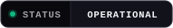
  </picture>
  &nbsp;
  <picture>
    <source media="(prefers-color-scheme: dark)" srcset="./assets/badges/engine-agentic.svg" />
    <source media="(prefers-color-scheme: light)" srcset="./assets/badges/engine-agentic-light.svg" />
    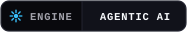
  </picture>
  &nbsp;
  <picture>
    <source media="(prefers-color-scheme: dark)" srcset="./assets/badges/flow-velocity.svg" />
    <source media="(prefers-color-scheme: light)" srcset="./assets/badges/flow-velocity-light.svg" />
    
  </picture>
  &nbsp;
  <picture>
    <source media="(prefers-color-scheme: dark)" srcset="./assets/badges/rig-titanium.svg" />
    <source media="(prefers-color-scheme: light)" srcset="./assets/badges/rig-titanium-light.svg" />
    
  </picture>

 

<!-- 4. REAL-TIME DISCORD PRESENCE & ENCRYPTED COMMS NEXUS -->

  <a href="https://discord.com/users/1158679630266519563" target="_blank">
    <picture>
      <source media="(prefers-color-scheme: dark)" srcset="https://lanyard-profile-readme.vercel.app/api/1158679630266519563?theme=dark&animated=true&bg=0c0c12&borderRadius=12px" />
      <source media="(prefers-color-scheme: light)" srcset="https://lanyard-profile-readme.vercel.app/api/1158679630266519563?theme=light&animated=true&bg=ffffff&borderRadius=12px" />
      
    </picture>
  </a>

 

  
<b>✦ NETWORK NEXUS // DIRECT COMMS ✦</b>

  <a href="https://guns.lol/hieupeak" target="_blank">
    <picture>
      <source media="(prefers-color-scheme: dark)" srcset="./assets/badges/guns.svg" />
      <source media="(prefers-color-scheme: light)" srcset="./assets/badges/guns-light.svg" />
      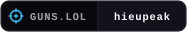
    </picture>
  </a>
  &nbsp;
  <a href="https://discord.com/users/1158679630266519563" target="_blank">
    <picture>
      <source media="(prefers-color-scheme: dark)" srcset="./assets/badges/discord.svg" />
      <source media="(prefers-color-scheme: light)" srcset="./assets/badges/discord-light.svg" />
      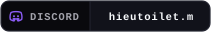
    </picture>
  </a>
  &nbsp;
  <a href="https://xbox.com/play/user/Hieupeak7238" target="_blank">
    <picture>
      <source media="(prefers-color-scheme: dark)" srcset="./assets/badges/xbox.svg" />
      <source media="(prefers-color-scheme: light)" srcset="./assets/badges/xbox-light.svg" />
      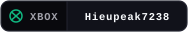
    </picture>
  </a>
  &nbsp;
  <a href="https://www.tiktok.com/@nhh2ler11" target="_blank">
    <picture>
      <source media="(prefers-color-scheme: dark)" srcset="./assets/badges/tiktok.svg" />
      <source media="(prefers-color-scheme: light)" srcset="./assets/badges/tiktok-light.svg" />
      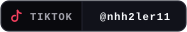
    </picture>
  </a>
  &nbsp;
  <a href="https://reddit.com/user/Hieupeak0109/" target="_blank">
    <picture>
      <source media="(prefers-color-scheme: dark)" srcset="./assets/badges/reddit.svg" />
      <source media="(prefers-color-scheme: light)" srcset="./assets/badges/reddit-light.svg" />
      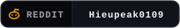
    </picture>
  </a>
  &nbsp;
  <a href="https://facebook.com/profile.php?id=100093105391256" target="_blank">
    <picture>
      <source media="(prefers-color-scheme: dark)" srcset="./assets/badges/facebook.svg" />
      <source media="(prefers-color-scheme: light)" srcset="./assets/badges/facebook-light.svg" />
      
    </picture>
  </a>

 

  <picture>
    <source media="(prefers-color-scheme: dark)" srcset="./assets/divider.svg" />
    <source media="(prefers-color-scheme: light)" srcset="./assets/divider-light.svg" />
    
  </picture>

 

<!-- 5. LIVE CODEBASE TELEMETRY DASHBOARD (GENERATED FROM GITHUB API & CONTRIBUTION CALENDAR) -->

  
<b>✦ CODEBASE TELEMETRY // REAL-TIME SYSTEM METRICS ✦</b>

  <picture>
    <source media="(prefers-color-scheme: dark)" srcset="./assets/telemetry-dashboard.svg" />
    <source media="(prefers-color-scheme: light)" srcset="./assets/telemetry-dashboard-light.svg" />
    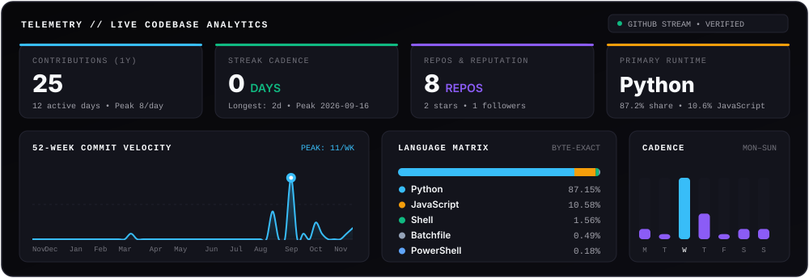
  </picture>

 

<!-- 6. FLAGSHIP ENGINEERING MODULES (CLICKABLE REPOSITORY CARDS) -->

  
<b>✦ FLAGSHIP ENGINEERING // DEPLOYED SYSTEMS ✦</b>

  <table border="0" width="100%">
    <tr>
      <td width="50%" align="center">
        <a href="https://github.com/hieupeakday0109-ai/Failure-to-Tool-Distiller">
          <picture>
            <source media="(prefers-color-scheme: dark)" srcset="./assets/cards/repo-failure-to-tool-distiller.svg" />
            <source media="(prefers-color-scheme: light)" srcset="./assets/cards/repo-failure-to-tool-distiller-light.svg" />
            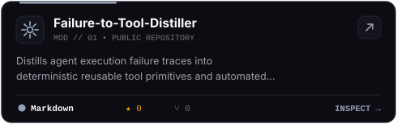
          </picture>
        </a>
      </td>
      <td width="50%" align="center">
        <a href="https://github.com/hieupeakday0109-ai/Video-to-ASCII">
          <picture>
            <source media="(prefers-color-scheme: dark)" srcset="./assets/cards/repo-video-to-ascii.svg" />
            <source media="(prefers-color-scheme: light)" srcset="./assets/cards/repo-video-to-ascii-light.svg" />
            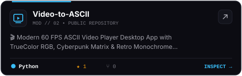
          </picture>
        </a>
      </td>
    </tr>
    <tr>
      <td width="50%" align="center">
        <a href="https://github.com/hieupeakday0109-ai/Scann-the-device">
          <picture>
            <source media="(prefers-color-scheme: dark)" srcset="./assets/cards/repo-scann-the-device.svg" />
            <source media="(prefers-color-scheme: light)" srcset="./assets/cards/repo-scann-the-device-light.svg" />
            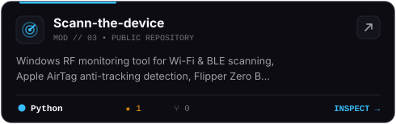
          </picture>
        </a>
      </td>
      <td width="50%" align="center">
        <a href="https://github.com/hieupeakday0109-ai/security-check">
          <picture>
            <source media="(prefers-color-scheme: dark)" srcset="./assets/cards/repo-security-check.svg" />
            <source media="(prefers-color-scheme: light)" srcset="./assets/cards/repo-security-check-light.svg" />
            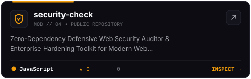
          </picture>
        </a>
      </td>
    </tr>
    <tr>
      <td width="50%" align="center">
        <a href="https://github.com/hieupeakday0109-ai/LYRIC-DISCORD">
          <picture>
            <source media="(prefers-color-scheme: dark)" srcset="./assets/cards/repo-lyric-discord.svg" />
            <source media="(prefers-color-scheme: light)" srcset="./assets/cards/repo-lyric-discord-light.svg" />
            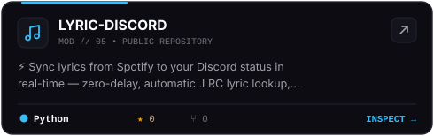
          </picture>
        </a>
      </td>
      <td width="50%" align="center">
        <a href="https://github.com/hieupeakday0109-ai/key-fast-for-c-">
          <picture>
            <source media="(prefers-color-scheme: dark)" srcset="./assets/cards/repo-key-fast-for-c-.svg" />
            <source media="(prefers-color-scheme: light)" srcset="./assets/cards/repo-key-fast-for-c--light.svg" />
            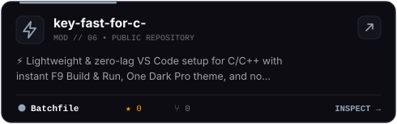
          </picture>
        </a>
      </td>
    </tr>
  </table>

 

  <picture>
    <source media="(prefers-color-scheme: dark)" srcset="./assets/divider.svg" />
    <source media="(prefers-color-scheme: light)" srcset="./assets/divider-light.svg" />
    
  </picture>

 

<!-- 7. ARCHITECTURAL ARSENAL // CORE STACK -->

  
<b>✦ ARCHITECTURAL ARSENAL // CORE STACK ✦</b>

  <table border="0">
    <tr align="center">
      <td><b>FRONTEND &amp; INTERACTION</b></td>
      <td><b>BACKEND &amp; SYSTEMS</b></td>
    </tr>
    <tr align="center">
      <td>
        <a href="https://skillicons.dev">
          <picture>
            <source media="(prefers-color-scheme: dark)" srcset="https://skillicons.dev/icons?i=react,nextjs,tailwind,ts,js,html,css&perline=7&theme=dark" />
            <source media="(prefers-color-scheme: light)" srcset="https://skillicons.dev/icons?i=react,nextjs,tailwind,ts,js,html,css&perline=7&theme=light" />
            
          </picture>
        </a>
      </td>
      <td>
        <a href="https://skillicons.dev">
          <picture>
            <source media="(prefers-color-scheme: dark)" srcset="https://skillicons.dev/icons?i=nodejs,express,python,cpp,cs,linux&perline=6&theme=dark" />
            <source media="(prefers-color-scheme: light)" srcset="https://skillicons.dev/icons?i=nodejs,express,python,cpp,cs,linux&perline=6&theme=light" />
            
          </picture>
        </a>
      </td>
    </tr>
    <tr align="center">
      <td><b>DATABASE &amp; CACHE</b></td>
      <td><b>DEVOPS &amp; INFRASTRUCTURE</b></td>
    </tr>
    <tr align="center">
      <td>
        <a href="https://skillicons.dev">
          <picture>
            <source media="(prefers-color-scheme: dark)" srcset="https://skillicons.dev/icons?i=postgres,mongodb,mysql,redis&perline=4&theme=dark" />
            <source media="(prefers-color-scheme: light)" srcset="https://skillicons.dev/icons?i=postgres,mongodb,mysql,redis&perline=4&theme=light" />
            
          </picture>
        </a>
      </td>
      <td>
        <a href="https://skillicons.dev">
          <picture>
            <source media="(prefers-color-scheme: dark)" srcset="https://skillicons.dev/icons?i=git,github,docker,vscode,powershell&perline=5&theme=dark" />
            <source media="(prefers-color-scheme: light)" srcset="https://skillicons.dev/icons?i=git,github,docker,vscode,powershell&perline=5&theme=light" />
            
          </picture>
        </a>
      </td>
    </tr>
  </table>

 

<!-- 8. APEX SUPERCAR CONTRIBUTION HIGHWAY (2X SUPERSAMPLED & LIVE-SYNCED) -->

  
<b>✦ APEX GT-01 // LIVE CONTRIBUTION HIGHWAY ✦</b>

  

 

<!-- 9. ANIMATED SOUNDSCAPE DECK -->

  <picture>
    <source media="(prefers-color-scheme: dark)" srcset="./assets/audio-deck.svg" />
    <source media="(prefers-color-scheme: light)" srcset="./assets/audio-deck-light.svg" />
    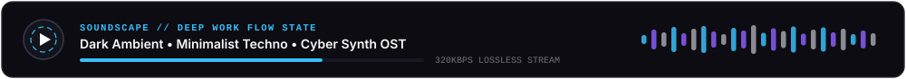
  </picture>

 

<!-- 10. CLASSIFIED SPEC DOSSIER -->

  

    
<b>⚡ [SECURITY CLEARANCE // DECRYPT OPERATIONAL DOSSIER] ⚡</b>

     
    <table>
      <tr>
        <th align="left">SUBSYSTEM</th>
        <th align="left">SPECIFICATION</th>
      </tr>
      <tr>
        <td><code>WORKSTATION</code></td>
        <td>Windows 11 Pro / Arch Linux (Dual-Boot High-Performance Rig)</td>
      </tr>
      <tr>
        <td><code>ENVIRONMENT</code></td>
        <td>Visual Studio Code [Obsidian Titanium Minimalist] + PowerShell</td>
      </tr>
      <tr>
        <td><code>CORE FOCUS</code></td>
        <td>Autonomous AI Agents, RF/BLE Security, Real-Time Graphics &amp; Tooling</td>
      </tr>
      <tr>
        <td><code>DESIGN SYSTEM</code></td>
        <td>Obsidian Titanium Tokens &bull; 3D Wireframe Telemetry &bull; Interactive <a href="./docs/index.html">WebGL Command Deck</a></td>
      </tr>
      <tr>
        <td><code>COMBAT ARENA</code></td>
        <td>Apex Legends, Warzone, Cyberpunk RPGs</td>
      </tr>
      <tr>
        <td><code>PRINCIPLE</code></td>
        <td><i>"Simplicity is prerequisite for reliability. Precision commands respect."</i></td>
      </tr>
    </table>
  

 

<!-- 11. IDENTITY & RANK VERIFICATION -->

  <picture>
    <source media="(prefers-color-scheme: dark)" srcset="./assets/badges/auth-verified.svg" />
    <source media="(prefers-color-scheme: light)" srcset="./assets/badges/auth-verified-light.svg" />
    
  </picture>
  &nbsp;
  <picture>
    <source media="(prefers-color-scheme: dark)" srcset="./assets/badges/rank-apex.svg" />
    <source media="(prefers-color-scheme: light)" srcset="./assets/badges/rank-apex-light.svg" />
    
  </picture>
  &nbsp;
  <picture>
    <source media="(prefers-color-scheme: dark)" srcset="./assets/badges/class-architect.svg" />
    <source media="(prefers-color-scheme: light)" srcset="./assets/badges/class-architect-light.svg" />
    
  </picture>

 

<!-- 12. OBSIDIAN TITANIUM CLOSING MONOLITH -->

  <picture>
    <source media="(prefers-color-scheme: dark)" srcset="./assets/footer.svg" />
    <source media="(prefers-color-scheme: light)" srcset="./assets/footer-light.svg" />
    
  </picture>

