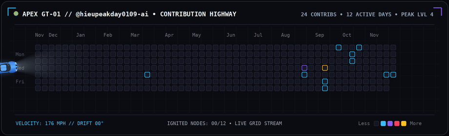

  <!-- 1. HERO ARCHITECT MASTHEAD: OBSIDIAN TITANIUM STEALTH BANNER -->
  

  <!-- 2. HIGH-PRECISION DYNAMIC TERMINAL (JETBRAINS MONO TITANIUM SILVER) -->
  

  <!-- METALLIC GRADIENT DIVIDER -->
  

 

<!-- 3. EXECUTIVE SYSTEM TELEMETRY: BẢNG TRẠNG THÁI HỆ THỐNG -->

  <table border="0">
    <tr align="center">
      <td>
        
      </td>
      <td>
        
      </td>
      <td>
        
      </td>
      <td>
        
      </td>
    </tr>
  </table>

 

<!-- 4. REAL-TIME TELEMETRY // DISCORD ACTIVITY -->

  

 

<!-- 5. NETWORK NEXUS // ENCRYPTED COMMS & CONTACT -->

  
<b>✦ CONNECT // COMMS & SQUAD QUEUE ✦</b>

  
  &nbsp;
  
  &nbsp;
  
  &nbsp;
  
  &nbsp;
  
  &nbsp;
  

 

  

 

<!-- 6. ARSENAL & ARCHITECTURAL MATRIX: HỆ THỐNG CÔNG NGHỆ CHUYÊN BIỆT -->

  
<b>✦ ARCHITECTURAL ARSENAL // CORE DISCIPLINES ✦</b>

   
  
  <table border="0">
    <tr align="center">
      <td><b>⚡ FRONTEND & INTERACTION</b></td>
      <td><b>⚔️ BACKEND & SYSTEMS</b></td>
    </tr>
    <tr align="center">
      <td>
        
      </td>
      <td>
        
      </td>
    </tr>
    <tr align="center">
      <td><b>🛡️ DATABASE & CACHE ARCHITECTURE</b></td>
      <td><b>🚀 DEVOPS & BATTLE INFRASTRUCTURE</b></td>
    </tr>
    <tr align="center">
      <td>
        
      </td>
      <td>
        
      </td>
    </tr>
  </table>

 

  

 

<!-- 7. GITHUB ANALYTICS & TELEMETRY: CHỈ SỐ HOẠT ĐỘNG THỜI GIAN THỰC -->

  
<b>✦ CODEBASE TELEMETRY // SYSTEM METRICS ✦</b>

   
  <table border="0">
    <tr align="center">
      <td>
        
      </td>
      <td>
        
      </td>
    </tr>
    <tr align="center">
      <td colspan="2">
         
        
      </td>
    </tr>
  </table>

 

  

 

<!-- 8. COMMIT HIGHWAY // HIGH-VELOCITY REPOSITORY STREAM -->

  
<b>🏎️ COMMIT HIGHWAY // MERGE & COMMIT TO THE DRIVE 🏎️</b>

   
  

 

<!-- 9. SOUNDSCAPE AUDIO DECK -->

  <table border="0">
    <tr>
      <td align="center">
        <b>🎧 SOUNDSCAPE // DEEP WORK FLOW STATE</b> 
        <code>[ ▶ 02:45 / 03:30 ] ▰▰▰▰▰▰▰▰▰▰▱▱ 320kbps Lossless</code> 
        <i>Vibe: Dark Ambient • Minimalist Techno • Cyber Synth OST</i>
      </td>
    </tr>
  </table>

 

<!-- 10. CLASSIFIED SPEC DOSSIER: THÔNG SỐ TRẠM TÁC CHIẾN -->

  

    
<b>⚡ [SECURITY CLEARANCE // DECRYPT OPERATIONAL DOSSIER] ⚡</b>

     
    <table border="0">
      <tr>
        <td align="left">
          <code>🖥️ WORKSTATION  : Windows 11 Pro / Arch Linux (Dual-Boot High-End Rig)</code> 
          <code>⌨️ ENVIRONMENT  : Visual Studio Code [Obsidian Dark Minimalist]</code> 
          <code>🧠 CORE FOCUS   : Autonomous Agents, Distributed Systems, UI/UX Craft</code> 
          <code>🎯 PHILOSOPHY   : "Simplicity is prerequisite for reliability. Design commands respect."</code> 
          <code>⚔️ COMBAT ARENA : Apex Legends, Warzone, Cyberpunk RPGs</code> 
          <code>⚡ CADENCE      : Continuous Deployment • Relentless Iteration</code>
        </td>
      </tr>
    </table>
  

 

<!-- 11. VISITOR METRICS & REPUTATION -->

  
  &nbsp;&nbsp;
  
  &nbsp;&nbsp;
  

 

<!-- 12. FOOTER: OBSIDIAN TITANIUM CLOSING CREDIT -->

  

